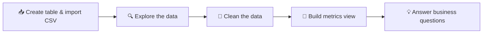

<div align="center">


<br/>

**🐘 PostgreSQL &nbsp;•&nbsp; 🛠️ pgAdmin &nbsp;•&nbsp; 🧮 SQL &nbsp;•&nbsp; 📦 Inventory Analytics**

</div>

---

## 🚀 About the Project

Quick-commerce apps like **Zepto** live and die by their inventory: what is in stock, what is discounted, and what is sitting idle on the shelf.

This project analyses a **Zepto product inventory dataset** using **pure SQL in PostgreSQL (pgAdmin)**. It goes through the full flow of exploring the data, cleaning it, building metrics and answering business questions.

> 🎯 **Goal:** turn raw product data into clear answers about pricing, discounts and stock.

---

## 📦 Dataset

The data is a Zepto inventory dataset from **Kaggle**. Each row is one product (SKU).

| Column | Meaning |
|---|---|
| 🔑 `sku_id` | Unique product ID |
| 🗂️ `category` | Product category |
| 🏷️ `name` | Product name |
| 💰 `mrp` | Maximum retail price |
| 🔻 `discount_percent` | Discount given (%) |
| 🛒 `discount_selling_price` | Price after discount |
| 📦 `available_quantity` | Units currently available |
| ⚖️ `weight_in_grams` | Product weight |
| 🚫 `out_of_stock` | `true` if the product is unavailable |
| 🔢 `quantity` | Quantity per pack |

---

## 🔄 Project Workflow



---

## 🔍 Step 1: Data Exploration

Before changing anything, I checked what the data looks like.

- ✅ Previewed the data with `select *` and `limit 10`
- ✅ Counted the total rows
- ✅ Checked every column for **NULL values**
- ✅ Listed the distinct **product categories**
- ✅ Compared **in-stock vs out-of-stock** products
- ✅ Found **product names that appear more than once**

<details>
<summary>👀 Click to see the exploration SQL</summary>

```sql
-- null check
select * from zepto
where name is null or category is null or mrp is null
   or discount_percent is null or discount_selling_price is null
   or weight_in_grams is null or available_quantity is null
   or out_of_stock is null or quantity is null;

-- in stock vs out of stock
select out_of_stock, count(sku_id) from zepto group by out_of_stock;

-- product names present multiple times
select name, count(sku_id) as "Number of products present"
from zepto
group by name
having count(sku_id) > 1
order by count(sku_id) desc;
```

</details>

---

## 🧹 Step 2: Data Cleaning

| Problem | Fix |
|---|---|
| Products with a **price of zero** (`mrp = 0`) | Found them and **deleted** those rows |
| Prices stored in **paise** instead of rupees | Divided `mrp` and `discount_selling_price` by 100 |

```sql
delete from zepto where mrp = 0;

update zepto
set mrp = mrp / 100.0,
    discount_selling_price = discount_selling_price / 100.0;
```


---

## 🧮 Step 3: Metrics View

I created a reusable SQL view called **`metrics`** that adds ready-made business columns to every product.

| Metric | What it tells you |
|---|---|
| 💸 `discount_amount` | Rupees saved per product (MRP minus selling price) |
| 📉 `calculated_discount_percent` | Discount % worked out from the actual prices |
| 🏦 `inventory_value_at_mrp` | Value of the stock at full price |
| 🛍️ `discounted_inventory_value` | Value of the stock at the selling price |
| 🎁 `potential_customer_savings` | Total savings customers get if all the stock is sold |
| ⚖️ `price_per_gram` | Price per gram, to compare value across products |

<details>
<summary>👀 Click to see the view SQL</summary>

```sql
create or replace view metrics as
select
    sku_id, category, name, mrp, discount_percent,
    discount_selling_price, available_quantity,
    weight_in_grams, out_of_stock,
    round((mrp - discount_selling_price)::numeric, 2) as discount_amount,
    round(((mrp - discount_selling_price) * 100.0 / nullif(mrp, 0))::numeric, 2) as calculated_discount_percent,
    round((mrp * available_quantity)::numeric, 2) as inventory_value_at_mrp,
    round((discount_selling_price * available_quantity)::numeric, 2) as discounted_inventory_value,
    round(((mrp - discount_selling_price) * available_quantity)::numeric, 2) as potential_customer_savings,
    round((discount_selling_price / nullif(weight_in_grams, 0))::numeric, 2) as price_per_gram
from zepto;
```

</details>

---

## 📊 Step 4: Price Summary

A quick look at the price range: minimum, maximum and average for both **MRP** and **selling price**.

```sql
select
    min(mrp) as minimum_mrp,
    max(mrp) as maximum_mrp,
    round(avg(mrp)::numeric, 2) as average_mrp,
    min(discount_selling_price) as minimum_selling_price,
    max(discount_selling_price) as maximum_selling_price,
    round(avg(discount_selling_price)::numeric, 2) as average_selling_price
from zepto;
```

---

## 📜 Complete SQL: Setup, Exploration, Cleaning and Metrics

Everything from Steps 1 to 4 in one script, in the order I ran it.

<details>
<summary>👀 <b>Click to see the full SQL (create table → exploration → cleaning → metrics view)</b></summary>

```sql
-- =====================================================
--  ZEPTO INVENTORY ANALYSIS  |  PostgreSQL (pgAdmin)
-- =====================================================

-- 1. CREATE TABLE
drop table if exists zepto;

create table zepto(
    sku_id serial primary key,
    category varchar(120),
    name varchar(150) not null,
    mrp numeric(8,2),
    discount_percent numeric(5,2),
    available_quantity integer,
    discount_selling_price numeric(8,2),
    weight_in_grams integer,
    out_of_stock boolean,
    quantity integer
);

-- (Import the Kaggle CSV into this table using pgAdmin's Import/Export tool)

-- 2. DATA EXPLORATION
select * from zepto;                       -- overview
select * from zepto limit 10;              -- sample data
select count(*) from zepto;                -- number of rows

-- null check
select * from zepto
where name is null or category is null or mrp is null
   or discount_percent is null or discount_selling_price is null
   or weight_in_grams is null or available_quantity is null
   or out_of_stock is null or quantity is null;

-- different product categories
select distinct category from zepto order by category;

-- in stock vs out of stock
select out_of_stock, count(sku_id) from zepto group by out_of_stock;

-- product names present multiple times
select name, count(sku_id) as "Number of products present"
from zepto
group by name
having count(sku_id) > 1
order by count(sku_id) desc;

-- 3. DATA CLEANING
-- products with price zero
select * from zepto where mrp = 0 or discount_selling_price = 0;

delete from zepto where mrp = 0;

-- convert prices from paise to rupees (run this ONCE only)
update zepto
set mrp = mrp / 100.0,
    discount_selling_price = discount_selling_price / 100.0;

select mrp, discount_selling_price from zepto;

-- 4. METRICS VIEW
drop view if exists metrics;

create or replace view metrics as
select
    sku_id,
    category,
    name,
    mrp,
    discount_percent,
    discount_selling_price,
    available_quantity,
    weight_in_grams,
    out_of_stock,
    -- discount amount
    round((mrp - discount_selling_price)::numeric, 2) as discount_amount,
    -- calculated discount percentage
    round(((mrp - discount_selling_price) * 100.0 / nullif(mrp, 0))::numeric, 2) as calculated_discount_percent,
    -- inventory value at mrp
    round((mrp * available_quantity)::numeric, 2) as inventory_value_at_mrp,
    -- discounted inventory value
    round((discount_selling_price * available_quantity)::numeric, 2) as discounted_inventory_value,
    -- potential customer savings
    round(((mrp - discount_selling_price) * available_quantity)::numeric, 2) as potential_customer_savings,
    -- price per gram
    round((discount_selling_price / nullif(weight_in_grams, 0))::numeric, 2) as price_per_gram
from zepto;

select count(*) from metrics;
select * from metrics limit 10;

-- 5. EDA: PRICE SUMMARY
select
    min(mrp) as minimum_mrp,
    max(mrp) as maximum_mrp,
    round(avg(mrp)::numeric, 2) as average_mrp,
    min(discount_selling_price) as minimum_discount_selling_price,
    max(discount_selling_price) as maximum_discount_selling_price,
    round(avg(discount_selling_price)::numeric, 2) as average_discount_selling_price
from zepto;
```

</details>

---

## 💡 Step 5: Business Questions Answered

<table>
<tr><th>#</th><th>Theme</th><th>Business Question</th></tr>
<tr><td>1</td><td>🗂️ Catalog</td><td>Which categories have the most products?</td></tr>
<tr><td>2</td><td>🔻 Discounts</td><td>Which products have the highest discounts (%)?</td></tr>
<tr><td>3</td><td>💸 Discounts</td><td>Which products give the biggest discount in rupees?</td></tr>
<tr><td>4</td><td>📊 Discounts</td><td>Which categories have the highest average discount?</td></tr>
<tr><td>5</td><td>🧮 Discounts</td><td>How are products spread across discount ranges?</td></tr>
<tr><td>6</td><td>🚫 Stock</td><td>What percentage of products are out of stock?</td></tr>
<tr><td>7</td><td>📉 Stock</td><td>Which categories have the most out-of-stock products?</td></tr>
<tr><td>8</td><td>⚠️ Stock</td><td>Which in-stock products are running lowest?</td></tr>
<tr><td>9</td><td>🏦 Inventory value</td><td>Which categories hold the most inventory value at MRP?</td></tr>
<tr><td>10</td><td>🛍️ Inventory value</td><td>Which categories hold the most inventory value at selling price?</td></tr>
<tr><td>11</td><td>⚖️ Value for money</td><td>Which products have the lowest price per gram?</td></tr>
<tr><td>12</td><td>🔥 Strategy</td><td>Which categories combine high discounts with high stock?</td></tr>
</table>

<details>
<summary>🗂️ <b>Catalog and discount questions (Q1 to Q5)</b></summary>

```sql
-- Q1. Categories with the most products
select category, count(*) as total_products
from zepto
group by category
order by total_products desc;

-- Q2. Products with the highest discounts
select name, category, discount_percent
from zepto
order by discount_percent desc
limit 10;

-- Q3. Highest discounts in rupees
select name, mrp, discount_selling_price,
       mrp - discount_selling_price as discount_amount
from zepto
order by discount_amount desc
limit 10;

-- Q4. Categories with the highest average discount
select category, round(avg(discount_percent)::numeric, 2) as avg_discount
from zepto
group by category
order by avg_discount desc;

-- Q5. Products by discount range
select
    case
        when discount_percent = 0 then 'no discount'
        when discount_percent <= 10 then '1-10%'
        when discount_percent <= 25 then '11-25%'
        when discount_percent <= 50 then '26-50%'
        else 'above 50%'
    end as discount_range,
    count(*) as total_products
from zepto
group by discount_range
order by total_products desc;
```

</details>

<details>
<summary>📦 <b>Stock questions (Q6 to Q8)</b></summary>

```sql
-- Q6. Percentage of products out of stock
select
    round(count(*) filter (where out_of_stock = true) * 100.0
          / nullif(count(*), 0), 2) as out_of_stock_percentage
from zepto;

-- Q7. Categories with the most out-of-stock products
select category, count(*) as out_of_stock_products
from zepto
where out_of_stock = true
group by category
order by out_of_stock_products desc;

-- Q8. Lowest available stock (in-stock items only)
select name, category, available_quantity
from zepto
where available_quantity > 0
order by available_quantity asc
limit 10;
```

</details>

<details>
<summary>🏦 <b>Inventory value and strategy questions (Q9 to Q12)</b></summary>

```sql
-- Q9. Inventory value at MRP, by category
select category,
       round(sum(mrp * available_quantity)::numeric, 2) as inventory_value
from zepto
group by category
order by inventory_value desc;

-- Q10. Inventory value at selling price, by category
select category,
       round(sum(discount_selling_price * available_quantity)::numeric, 2) as discounted_inventory_value
from zepto
group by category
order by discounted_inventory_value desc;

-- Q11. Lowest price per gram
select name, category,
       round((discount_selling_price / nullif(weight_in_grams, 0))::numeric, 2) as price_per_gram
from zepto
where weight_in_grams > 0
order by price_per_gram asc
limit 10;

-- Q12. High discount + high stock categories
select category,
       round(avg(discount_percent)::numeric, 2) as avg_discount,
       sum(available_quantity) as total_stock
from zepto
group by category
order by avg_discount desc, total_stock desc;
```

</details>

---

## 🧰 SQL Skills Used

| Skill | Where it was used |
|---|---|
| 🔗 `GROUP BY` and `HAVING` | Finding duplicate names and category summaries |
| 🧮 Aggregates (`SUM`, `AVG`, `MIN`, `MAX`, `COUNT`) | Inventory value and price summary |
| 🔀 `CASE WHEN` | Grouping products into discount ranges |
| 🎯 `FILTER` clause | Out-of-stock percentage |
| 🛡️ `NULLIF` | Avoiding divide-by-zero errors |
| 🪟 Views | Reusable `metrics` view |
| ✏️ `UPDATE` and `DELETE` | Data cleaning |

---

## 🖱️ How to Run

1. 🐘 Install **PostgreSQL** and open **pgAdmin**
2. 🗄️ Create a new database
3. 📥 Download the **Zepto dataset** from Kaggle
4. ▶️ Run the table creation part of `zepto_analysis.sql`
5. 📂 Import the CSV into the `zepto` table using pgAdmin's **Import/Export** tool
6. 🧹 Run the cleaning section, then the metrics view and business questions

---

## 📁 Project Structure

```
📦 Zepto-SQL-Analysis
 ┣ 📂 assets
 ┃ ┣ 🖼️ header.svg
 ┃ ┣ 🖼️ typing.svg
 ┃ ┗ 🖼️ footer.svg
 ┣ 📂 data
 ┃ ┗ 📄 zepto.csv
 ┣ 📝 zepto_analysis.sql
 ┗ 📝 README.md
```

---

<div align="center">

⭐ **If you liked this project, give it a star!** ⭐


</div>
